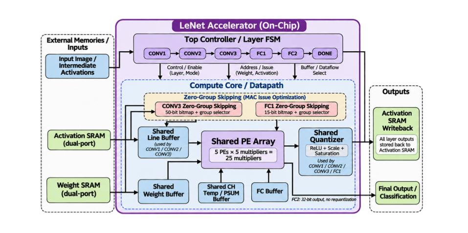

# LeNet CNN 加速器

使用 **SystemVerilog** 設計五層 LeNet CNN 硬體加速器，透過**硬體資源共享、資料重用與 Zero-Activation Group Skipping**，降低硬體面積及推論延遲。

## 最佳化成果

| 項目 | 結果 |
|---|---|
| Clock Period | **10 ns（Timing MET）** |
| Cell Area | **505,781 μm²** |
| 面積降低 | **46.60%** |
| 推論週期 | **29,481 cycles** |
| 週期減少 | **6.40%** |
| 功能驗證 | **Golden PASS / Gate-Level PASS** |

*面積以初始版本為基準；週期改善以導入 Zero Skipping 前的版本為基準。*

## 架構與最佳化重點

- **Shared PE Array：** 五層共用 5 個 PE，共 25 個 8-bit 乘法器。
- **Memory Reuse：** 共用 Line Buffer、Weight Buffer 與 Partial-Sum Buffer，減少硬體資源。
- **Shared Quantizer：** 共用 ReLU 與量化電路，降低重複運算硬體面積。
- **Zero-Activation Group Skipping：** 在 CONV3 與 FC1 跳過全零 MAC Group，共減少 **2,016 cycles**。

## 硬體架構圖

## 技術文件

- [微架構說明書](docs/LeNet_architecture_v2.0.pdf)
- [RTL 最佳化紀錄](docs/Optimization.md)

**開發工具：** SystemVerilog、Synopsys Design Compiler、VCS、Verdi